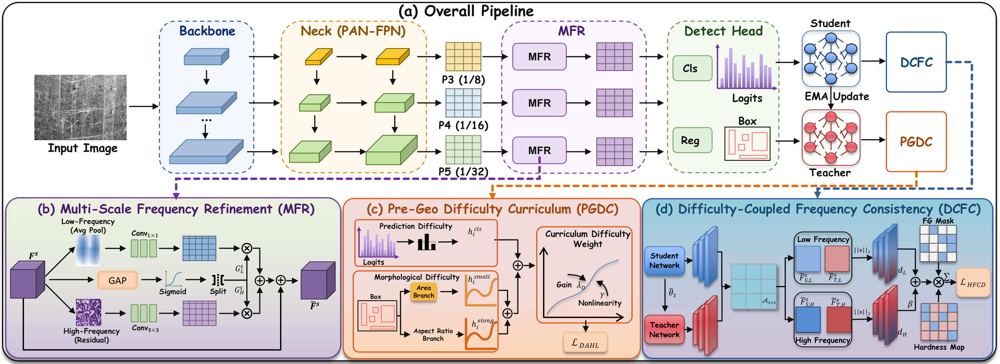

<div align="center">
  <h1>FreD</h1>
  <p><strong>Coupling Frequency Refinement and Difficulty-Guided Learning<br>for Industrial Surface Defect Detection</strong></p>
</div>

FreD is a lightweight framework for industrial surface defect detection, built on YOLO11n. It couples multi-scale frequency refinement with difficulty-guided detection supervision and EMA-teacher consistency learning to address small, elongated, low-contrast, and texture-confusable defects.

## Method Overview

<p align="center">
  
</p>

<p align="center">
  <a href="assets/pipline.pdf">View the pipeline as a vector PDF</a>
</p>

FreD connects three components through the features and predictions of the detector:

- **Multi-Scale Frequency Refinement (MFR)** refines the P3, P4, and P5 features. Each feature map is decomposed into local low-frequency context and a high-frequency residual. Input-dependent channel gates modulate the two branches before residual fusion.
- **Prediction-Geometry Difficulty Curriculum (PGDC)** estimates instance difficulty from classification uncertainty, relative target size, and elongation. A progressive curriculum uses this shared difficulty to reweight positive classification and localization supervision.
- **Difficulty-Coupled Frequency Consistency (DCFC)** uses an exponential moving average (EMA) teacher to regularize low- and high-frequency features at foreground locations. The same difficulty estimates emphasize challenging defects, and consistency learning is introduced after a warm-up period.

PGDC and DCFC are used during training. At inference, FreD uses the detector with MFR, without the teacher or the additional training objectives.

### Paper and Code Terminology

The implementation retains the following identifiers for compatibility with the existing configuration files and checkpoints:

| Paper component | Implementation identifiers | Main location |
| --- | --- | --- |
| MFR | `FrequencyAdaptiveModulation`, `fafm` | [`block.py`](ultralytics/nn/modules/block.py), [`yolo11-fafm.yaml`](ultralytics/cfg/models/11/yolo11-fafm.yaml) |
| PGDC | `dahl_loss`, `dahl_gain`, `dahl_gamma`, `dahl_max_gain` | [`loss.py`](ultralytics/utils/loss.py) |
| DCFC | `hfcd_loss`, `hfcd_gain`, `hfcd_beta`, `hfcd_warmup_epochs` | [`loss.py`](ultralytics/utils/loss.py), [`trainer.py`](ultralytics/engine/trainer.py) |

The training launcher enables the complete FreD configuration through the internal mode `dahl_fafm_hfcd`.

## Results

The following results are reported in the accompanying manuscript (Tables 2 and 4). All detection metrics are percentages.

| Dataset | Precision | Recall | F1 | mAP50 | mAP50:95 |
| --- | ---: | ---: | ---: | ---: | ---: |
| NEU-DET | 67.43 | 73.83 | 70.49 | 76.29 | 43.28 |
| GC10-DET | 67.00 | 57.69 | 61.99 | 62.38 | 29.27 |
| CTDD | 73.69 | 68.03 | 70.75 | 75.02 | 37.03 |

On NEU-DET, the manuscript reports **2.69M parameters**, **6.49 GFLOPs**, and **354.28 FPS** (Table 3). The reported hardware is a single NVIDIA RTX 3090 with 24 GB of memory. These are manuscript measurements; inference speed depends on the evaluation environment and timing protocol.

## Getting Started

### Environment

The manuscript experiments use PyTorch 2.8.0 and CUDA 12.9. Create an environment and install a PyTorch build suitable for your CUDA setup before installing the remaining dependencies. For example:

```shell
conda create -n fred python=3.10 -y
conda activate fred

pip install torch torchvision
pip install numpy pillow tqdm pyyaml opencv-python matplotlib pandas seaborn psutil requests scipy ultralytics-thop
```

Run commands from the repository root so that Python imports the modified local `ultralytics/` package.

### Datasets

The manuscript uses the following datasets and split protocols:

| Dataset | Images | Split protocol |
| --- | ---: | --- |
| NEU-DET | 1,800 | 1,440 training / 360 validation; split seed 42 |
| GC10-DET | 2,280 | 80% training / 20% validation |
| CTDD (Copper Tube Defect Dataset) | 1,386 | 80% training / 10% validation / 10% test |

Each dataset has an experiment configuration:

| Dataset | Configuration | Dataset preparation |
| --- | --- | --- |
| NEU-DET | [`configs/neu_det.yaml`](configs/neu_det.yaml) | The launcher converts Pascal VOC XML annotations and creates the training/validation split. |
| GC10-DET | [`configs/gc10_det.yaml`](configs/gc10_det.yaml) | Prepare YOLO-format images, labels, and a dataset YAML before training. |
| CTDD | [`configs/ctdd.yaml`](configs/ctdd.yaml) | Prepare YOLO-format images, labels, and a dataset YAML with separate `train`, `val`, and `test` entries. |

Set `data_root` and `data_yaml` in the selected configuration to your dataset locations. Use absolute paths for both fields; the NEU-DET converter writes image-list and YAML paths from these values. Also use an absolute dataset `path` inside prepared GC10-DET and CTDD YAML files.

For NEU-DET, the converter expects:

```text
NEU-DET/
  ANNOTATIONS/
    *.xml
  IMAGES/
    *.jpg
```

The `save_dir` setting controls the parent directory for training outputs and defaults to `runs` in the provided configurations.

### Training

After updating the dataset paths, launch an experiment with:

```shell
# NEU-DET
python train.py --config configs/neu_det.yaml

# GC10-DET
python train.py --config configs/gc10_det.yaml

# CTDD
python train.py --config configs/ctdd.yaml
```

The launcher trains the full FreD model from scratch for **100 epochs**, with image size **640**, batch size **16**, **8** data-loading workers, and device **0**. These settings are fixed in `train.py`. The run name is the configuration filename without its extension, so the NEU-DET checkpoint is saved under:

```text
runs/neu_det/weights/best.pt
```

The main difficulty and consistency settings match the manuscript:

| Setting | Code parameter | Value |
| --- | --- | ---: |
| PGDC difficulty gain | `dahl_gain` | 0.65 |
| PGDC difficulty exponent | `dahl_gamma` | 1.25 |
| PGDC weight cap before normalization | `dahl_max_gain` | 1.50 |
| DCFC consistency strength | `hfcd_gain` | 0.05 |
| DCFC high-frequency weight | `hfcd_beta` | 1.00 |
| DCFC warm-up epochs | `hfcd_warmup_epochs` | 10 |

PGDC uses a relative-size reference of 0.20, an elongation threshold of 2, an elongation growth range of 4, and a prediction-difficulty mixing weight of 0.75. After warm-up, the DCFC coefficient increases linearly to its configured strength.

### Evaluation

Evaluate a trained checkpoint through the local Ultralytics Python API. Set `data_yaml` to the dataset YAML used for training:

```python
from pathlib import Path
from ultralytics import YOLO

data_yaml = str(Path("data/NEU-DET/yolo/neu_det.yaml").resolve())
model = YOLO("runs/neu_det/weights/best.pt")
metrics = model.val(
    data=data_yaml,
    split="val",
    imgsz=640,
    batch=16,
    device=0,
)
print("mAP50:", metrics.box.map50)
print("mAP50:95:", metrics.box.map)
```

For GC10-DET, select its checkpoint and dataset YAML. For CTDD, use the validation split for model selection and evaluate the final checkpoint with `split="test"` to follow the manuscript protocol.

### Prediction

Render detections and export YOLO-format prediction text files:

```python
from ultralytics import YOLO

model = YOLO("runs/neu_det/weights/best.pt")
model.predict(
    source="data/NEU-DET/IMAGES",
    imgsz=640,
    conf=0.25,
    device=0,
    save=True,
    save_txt=True,
    save_conf=True,
    project="runs",
    name="fred_predictions",
)
```

Replace `source` with the images or directory to inspect. Predictions are saved under `runs/fred_predictions/`.

## Repository Guide

| Path | Contents |
| --- | --- |
| [`train.py`](train.py) | Dataset preparation and the full FreD training launcher |
| [`configs/`](configs/) | Dataset-specific experiment configurations |
| [`ultralytics/nn/modules/block.py`](ultralytics/nn/modules/block.py) | MFR implementation (`FrequencyAdaptiveModulation`) |
| [`ultralytics/cfg/models/11/yolo11-fafm.yaml`](ultralytics/cfg/models/11/yolo11-fafm.yaml) | YOLO11 architecture with refinement at P3, P4, and P5 |
| [`ultralytics/utils/loss.py`](ultralytics/utils/loss.py) | PGDC weighting and DCFC frequency-consistency objectives |
| [`ultralytics/engine/trainer.py`](ultralytics/engine/trainer.py) | Training loop and EMA-teacher integration |
| [`assets/`](assets/) | Pipeline preview and vector PDF |

## Reference

Bin Xu, Xinda Yu, Licheng Ruan, Huihui Tan, Xinmin Cheng, and Ying Zang. **FreD: Coupling Frequency Refinement and Difficulty-Guided Learning for Industrial Surface Defect Detection.**

## Acknowledgment and License

This project builds on the [Ultralytics YOLO codebase](https://github.com/ultralytics/ultralytics). Please review the licensing terms of the upstream project before redistribution or commercial use.

For questions or reproducibility issues, open a GitHub issue with the dataset configuration, command, environment details, and error log.
